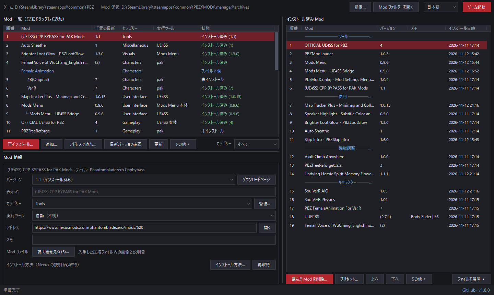
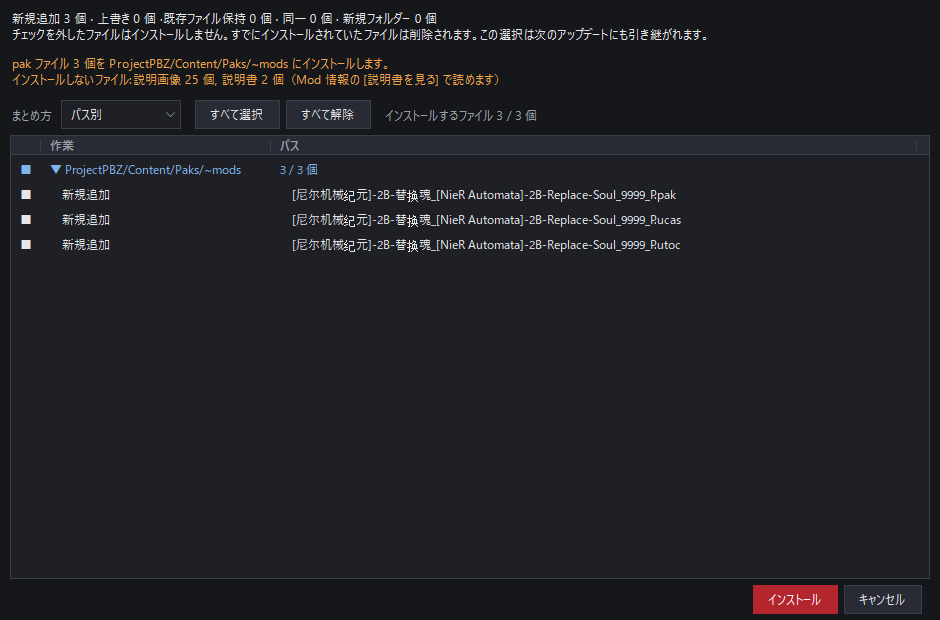
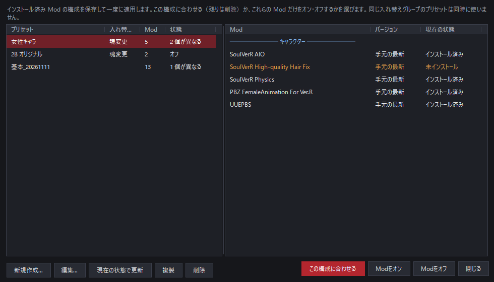
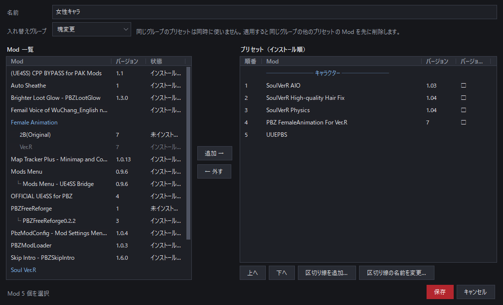

# PBZ Mod Manager

**[English](README.md) · [한국어](README.ko.md) · [简体中文](README.zh-CN.md) · 日本語**

Phantom Blade Zero 用の Mod マネージャーです。ダウンロードした Mod を正しい場所にインストールし、変更したファイルをすべて記録して、いつでもゲームフォルダーを元どおりに戻せます。

> **Steam 版を基準**に作っています。非公式のコミュニティツールで、ゲームの開発元や Nexus Mods とは関係ありません。

## クイックスタート

1. [.NET 8 デスクトップランタイム](https://dotnet.microsoft.com/download/dotnet/8.0)（x64）をインストールします。
2. [Releases](https://github.com/GameStdio77/PBZModManager/releases) から `PBZModManager.exe` をダウンロードし、好きなフォルダー（例：ゲームフォルダー内の `MOD`）に入れて実行します。
3. Mod の圧縮ファイル（zip・rar・7z）をウィンドウにドラッグし、情報ウィンドウのアドレス欄に **Nexus の Mod ページのアドレス**を入れます。
4. Mod を選んで [インストール...] を押し、プレビューを確認してインストールします。

## 主な機能

- **安全なインストールと削除**：上書きするファイルをバックアップし、削除すると元に戻します。
- **インストールのプレビュー**：各ファイルの行き先を確認し、不要なファイルを除外できます。
- **正しい場所に自動で**：JS・UE4SS・pak・ブループリント Mod をそれぞれ正しいフォルダーにインストールします。
- **アップデート確認**：Nexus Mods と GitHub で新しいバージョンを確認します。
- **バージョン管理**：同じ Mod の複数バージョンをまとめて、更新したり前のバージョンに戻したりします。
- **プリセット**：Mod の構成を保存し、一度にオン・オフします。
- **説明書・画像を見る**：圧縮ファイル内の readme と画像をマネージャーでそのまま見られます。
- **整理と共有**：インストール順、区切り線、メモ、右クリックメニュー、Mod 一覧の共有
- **4 言語**：한국어 · English · 简体中文 · 日本語

## 機能の詳細

### インストールと削除

- インストール時に上書きするファイルをすべてバックアップし、削除すると元に戻します。
- インストール後に変更されたファイルや Mod が作ったファイルは消さずに保管フォルダーへ移します。
- プレビューではファイルをパス別・作業別に表示し、チェックを外すと除外できます。除外したファイルは次のアップデートでも除外されます。
- 新しいバージョンのオプション構成やインストール先が大きく変わった場合、以前のバージョンを先に削除するよう案内します。
- ゲームの実行中はインストール・削除できません。

### インストール先

| Mod | インストール先 |
|---|---|
| JS Mod | インストールされている PBZModLoader（`ProjectPBZ/PBZModLoader/mods`）または Mods Menu（`.../JavaScript/PBZModsMenu/Mods`）。両方あれば Mods Menu |
| UE4SS 本体 | `platform/steam` |
| UE4SS の Lua Mod | `platform/steam/ue4ss/Mods` |
| pak Mod | `Content/Paks/~mods` |
| ブループリント Mod | `Content/Paks/LogicMods` |

「(choose one)」のように同じファイルを使うオプションフォルダーは、グループごとに 1 つ選んでインストールします。

### Mod 情報

- Mod ページのアドレスを入れると、Nexus の公開 API で**カテゴリーとインストール方法**を取得します。GitHub リポジトリのアドレスも使えます。
- Mod はファイル名ではなく **Nexus のページタイトル**で表示します。[表示名] に入力した名前が最優先です。
- [説明書を見る...] で圧縮ファイル内の readme・説明書（txt、md、rtf、html）をその場で読めます。PDF は PDF アプリで開きます。
  - 説明書はゲームフォルダーに置かれないようインストールから除外します。
- [画像を見る...] で圧縮ファイル内の画像を左右にめくって見られます。

### アップデートとバージョン

- [最新バージョン確認] を押すと、アドレスを入れた Mod ごとに新しいバージョンを確認します。確認は押したときだけ行います。
- 新しいバージョンがあればダウンロードページを開き、ダウンロードしたファイルをドラッグすると更新できます。
- 同じ Mod の複数バージョンを 1 つの Mod として更新・ダウングレードし、旧バージョンのファイルはごみ箱へ整理できます。
- 作者が Nexus でファイル名を変えても、同じ Mod の新バージョンとして引き継ぎます。
- 右クリックメニューから 1 つの Mod だけ確認したり、確認から外したりできます。

### プリセット

- インストール済み Mod の構成に名前を付けて保存し、[プリセット...] から一度に適用します。
- 適用方法は 3 つです。
  - **この構成に合わせる**：プリセットにない Mod は削除
  - **Modをオン**：プリセットの Mod だけをインストール
  - **Modをオフ**：プリセットの Mod だけを削除
- 同じ**入れ替えグループ**のプリセットは同時に使いません。一方を適用すると、同じグループの他のプリセットの Mod を先に削除します（両方にある Mod はそのまま）。
- インストール順、区切り線、バージョン固定、選んだオプション、除外ファイルまで保存します。
- 適用前に何が変わるかを表示します。

編集画面は左が Mod 一覧、右がプリセット（インストール順）です。Mod を追加・削除し、上下に移動できます。

### 整理と共有

- インストール済み Mod を並べ替え、名前付きの区切り線と 1 行メモを付けられます。
- 複数の Mod をまとめてインストール・削除できます。
- Mod を右クリックすると、インストール・削除、最新バージョン確認、ページを開く、説明書を見る、もう一方の一覧で探すなどがすぐにできます。
- [アドレスで追加...] で、まだ入手していない Mod の場所を確保できます。
- [一覧を共有...] で一覧をファイルか文章で送り、受け取る人は [一覧を取り込む...] で読み込みます。取り込みは場所を作るだけで、何もダウンロードしません。

### 設定

右上の [設定...] で変更します。

- ゲームフォルダー、Mod フォルダーを開く
- 順番列の表示、区切り線の形
- ゲーム起動時のマネージャーの動作：開いたまま / タスクバーに最小化 / 自動終了
- 保管フォルダーを開く・空にする

言語は右上で選び、再起動後に反映されます。

## 使い方の詳細

開く

1. ダウンロードした Mod ファイルとインストール記録は、すべて **exe の隣の `.manager` フォルダー**に保存されます。
2. ゲームフォルダーは自動で探します（exe の上位フォルダー、各ドライブの Steam ライブラリ）。見つからない場合は一度だけ選ぶよう求められ、後から [設定...] で変更できます。
3. ドラッグしたファイルはコピーではなく `.manager\archives` に**移動**されます。rar・7z は同じ名前の zip に変換して保管し、元のファイルはごみ箱に送ります。
4. 初めての Mod なら情報ウィンドウが開きます。**一番上のアドレス欄に Mod ページのアドレスを入力してください。** マネージャーが Mod のページを知る方法はこのアドレスだけです。
   - Nexus のアドレス（`https://www.nexusmods.com/phantombladezero/mods/番号`）：カテゴリーとインストール方法を自動取得します。
   - GitHub リポジトリのアドレス：GitHub のリリースでバージョンを確認します。
   - 既知の Mod の新しいバージョンは、以前のバージョンの情報を引き継ぎます。
5. Mod を選んで [インストール...] を押すとプレビューが出ます。除外したいファイルのチェックを外してインストールします。
6. [最新バージョン確認] で新しいバージョンを探し、ダウンロードしたファイルをドラッグすると更新できます。
7. 右上の [ゲーム起動] でゲームをすぐに起動できます。

## `.manager` フォルダー

開く

| 項目 | 内容 |
|---|---|
| `archives/` | 追加した Mod の圧縮ファイル。[Mod フォルダーを開く] で開けます。 |
| `history/` | インストール記録と上書きした元ファイルのバックアップ。削除・元に戻すときに必要なので消さないでください。 |
| `leftovers/` | 削除時に消さずに移したファイル。[設定...] からごみ箱へ空にできます。 |
| `meta.json` | Mod ごとのカテゴリー・アドレス・メモ・実行ツール・インストール方法 |
| `wanted.json`、`shared-order.json` | アドレスで確保した場所、取り込んだ一覧のインストール順 |
| `renames.json` | Nexus で名前が変わったファイルと元の Mod の対応 |
| `presets.json` | プリセット |
| `settings.json` | ゲームフォルダー、言語、ウィンドウ位置と設定 |
| `order.json`、`categories.json`、`remote.json`、`log.txt` | 一覧の順番と区切り線、カテゴリー、最新バージョン確認の結果、作業記録 |

## ネットワークの使用

- **Nexus Mods 公開 GraphQL API**（`api.nexusmods.com/v2/graphql`）：アドレスを入れたときにカテゴリー・インストール方法、[最新バージョン確認] を押したときに最新バージョン。API キーは使いません。
- **GitHub リリース API**（`api.github.com`）：GitHub で公開されている Mod の最新バージョン、および起動時に一度このマネージャーの新バージョン。
- ファイルはダウンロードせず、ダウンロードページをブラウザーで開きます。

## クレジット

- このプログラムは Anthropic の AI [Claude](https://claude.com/claude-code)（Claude Code）および Google の AI [Gemini](https://gemini.google.com/) を使って開発しました。
- rar・7z の読み込み：[SharpCompress](https://github.com/adamhathcock/sharpcompress)（MIT）
- ライセンス：[GNU General Public License v3.0](LICENSE)
