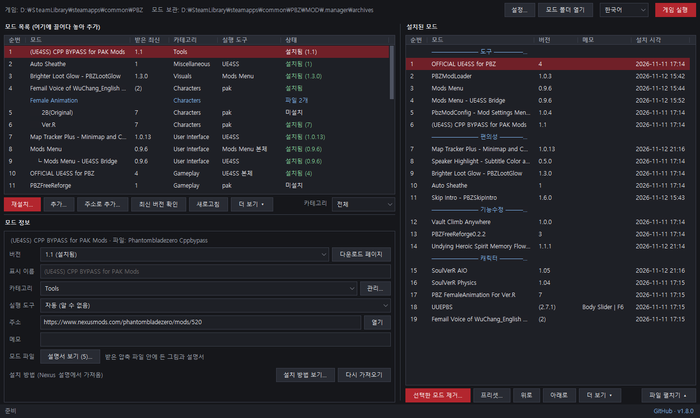
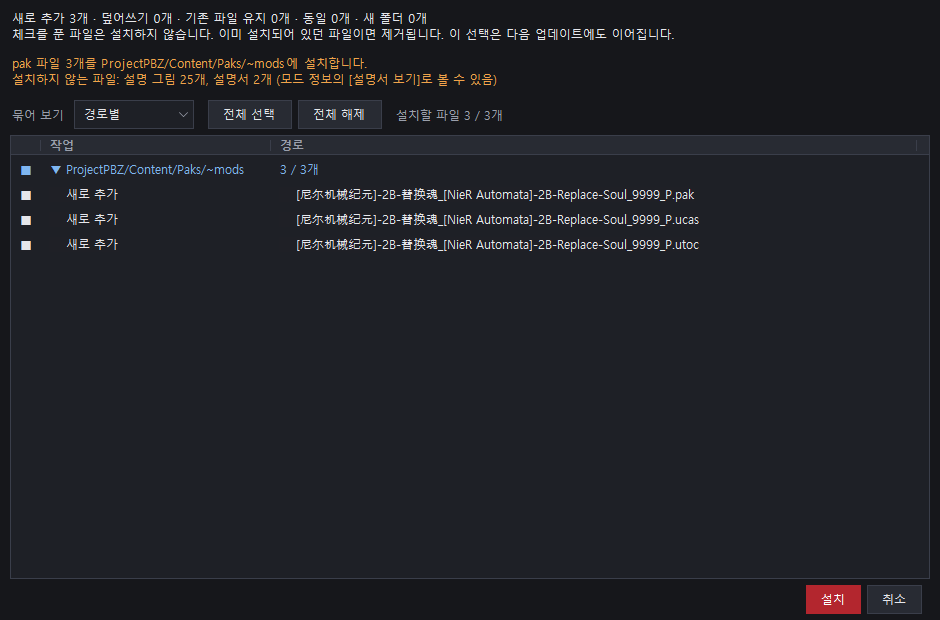
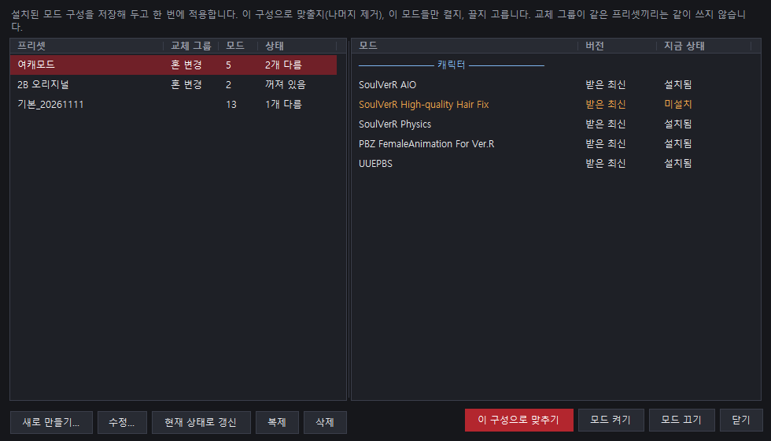
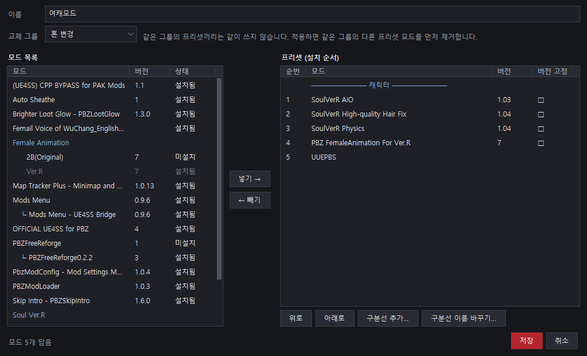

# PBZ Mod Manager

**[English](README.md) · 한국어 · [简体中文](README.zh-CN.md) · [日本語](README.ja.md)**

Phantom Blade Zero(팬텀 블레이드 제로)용 모드 매니저입니다. 받은 모드를 알맞은 자리에 설치하고, 설치한 내용을 기록해 두었다가 언제든 원래대로 되돌립니다.

> **Steam 버전 기준**으로 만들었습니다. 비공식 커뮤니티 도구이며 게임 제작사나 Nexus Mods와 관련이 없습니다.

## 빠른 시작

1. [.NET 8 데스크톱 런타임](https://dotnet.microsoft.com/download/dotnet/8.0)(x64)을 설치합니다.
2. [릴리스](https://github.com/GameStdio77/PBZModManager/releases)에서 `PBZModManager.exe`를 받아 원하는 폴더(예: 게임 폴더 안의 `MOD`)에 두고 실행합니다.
3. 받은 모드 압축 파일(zip·rar·7z)을 창에 끌어다 놓고, 정보 창의 주소 칸에 **Nexus 모드 페이지 주소**를 넣습니다.
4. 모드를 골라 [설치...]를 누르고, 미리보기를 확인한 뒤 설치합니다.

## 주요 기능

- **안전한 설치·제거**: 덮어쓰는 파일은 백업하고, 제거하면 원래대로 되돌립니다.
- **설치 미리보기**: 어떤 파일이 어디로 가는지 보고, 원하지 않는 파일은 뺄 수 있습니다.
- **알아서 맞는 자리에**: JS·UE4SS·pak·블루프린트 모드를 각각 맞는 폴더에 설치합니다.
- **업데이트 확인**: Nexus Mods와 GitHub에서 새 버전을 확인합니다.
- **버전 관리**: 같은 모드의 여러 버전을 묶어 업데이트하거나 이전 버전으로 돌아갑니다.
- **프리셋**: 모드 구성을 저장해 두고 한 번에 켜고 끕니다.
- **설명서·이미지 보기**: 압축 안의 readme와 그림을 매니저에서 바로 봅니다.
- **정리와 공유**: 설치 순서, 구분선, 메모, 우클릭 메뉴, 모드 목록 공유
- **4개 언어**: 한국어 · English · 简体中文 · 日本語

## 기능 자세히

### 설치와 제거

- 설치할 때 덮어쓰는 파일을 모두 백업하고, 제거하면 원래 상태로 되돌립니다.
- 설치 후 바뀐 파일이나 모드가 만든 파일은 지우지 않고 보관 폴더로 옮깁니다.
- 미리보기에서 파일을 경로별·작업별로 보고, 체크를 풀어 뺄 수 있습니다. 뺀 파일은 다음 업데이트에도 빠집니다.
- 새 버전의 옵션 구성이나 설치 위치가 크게 바뀌었으면 이전 버전을 먼저 제거하도록 안내합니다.
- 게임이 실행 중일 때는 설치·제거를 막습니다.

### 설치 위치

| 모드 | 설치 위치 |
|---|---|
| JS 모드 | PBZModLoader(`ProjectPBZ/PBZModLoader/mods`) 또는 Mods Menu(`.../JavaScript/PBZModsMenu/Mods`) 중 설치된 쪽. 둘 다 있으면 Mods Menu |
| UE4SS 본체 | `platform/steam` |
| UE4SS Lua 모드 | `platform/steam/ue4ss/Mods` |
| pak 모드 | `Content/Paks/~mods` |
| 블루프린트 모드 | `Content/Paks/LogicMods` |

"(choose one)"처럼 같은 파일을 쓰는 옵션 폴더는 묶음마다 하나씩 골라 설치합니다.

### 모드 정보

- 모드 페이지 주소를 넣으면 Nexus 공개 API로 **카테고리와 설치 방법**을 가져옵니다. GitHub 저장소 주소도 됩니다.
- 모드 이름은 파일 이름 대신 **Nexus 페이지 제목**으로 보여 줍니다. [표시 이름]에 직접 적은 이름이 가장 먼저 쓰입니다.
- [설명서 보기]로 압축 안의 readme·설명서(txt, md, rtf, html)를 바로 읽습니다. PDF는 PDF 프로그램으로 엽니다.
  - 설명서는 게임 폴더에 깔리지 않도록 설치에서 뺍니다.
- [이미지 보기]로 압축 안의 그림을 좌우로 넘겨 봅니다.

### 업데이트와 버전

- [최신 버전 확인]을 누르면 주소를 넣은 모드마다 새 버전이 있는지 확인합니다. 확인은 누를 때만 합니다.
- 새 버전이 있으면 다운로드 페이지를 열고, 받은 파일을 끌어다 놓으면 업데이트됩니다.
- 같은 모드의 여러 버전을 한 모드로 묶어 업데이트·다운그레이드하고, 이전 버전 파일은 휴지통으로 정리할 수 있습니다.
- 제작자가 Nexus에서 파일 이름을 바꿔도 같은 모드의 새 버전으로 이어집니다.
- 우클릭 메뉴에서 모드 하나만 확인하거나, 확인에서 뺄 수 있습니다.

### 프리셋

- 설치된 모드 구성을 이름 붙여 저장하고 [프리셋...]에서 한 번에 적용합니다.
- 적용 방식은 세 가지입니다.
  - **이 구성으로 맞추기**: 프리셋에 없는 모드는 제거
  - **모드 켜기**: 프리셋의 모드만 설치
  - **모드 끄기**: 프리셋의 모드만 제거
- **교체 그룹**이 같은 프리셋끼리는 같이 쓰지 않습니다. 하나를 적용하면 같은 그룹의 다른 프리셋 모드를 먼저 제거합니다(두 프리셋에 모두 있는 모드는 그대로).
- 설치 순서, 구분선, 버전 고정, 고른 옵션, 뺀 파일까지 저장합니다.
- 적용 전에 무엇이 바뀌는지 미리 보여 줍니다.

편집 창은 왼쪽이 모드 목록, 오른쪽이 프리셋(설치 순서)입니다. 모드를 넣고 빼고 위아래로 옮깁니다.

### 정리와 공유

- 설치된 모드의 순서를 바꾸고, 이름 붙인 구분선과 한 줄 메모를 답니다.
- 여러 모드를 한 번에 설치·제거합니다.
- 모드를 우클릭하면 설치·제거, 최신 버전 확인, 페이지 열기, 설명서 보기, 다른 목록에서 찾기 등을 바로 할 수 있습니다.
- [주소로 추가...]로 아직 받지 않은 모드의 자리를 잡아 둡니다.
- [목록 공유...]로 내 목록을 파일이나 글로 보내고, 받는 사람은 [목록 가져오기...]로 불러옵니다. 가져오기는 자리만 만들고 아무것도 내려받지 않습니다.

### 설정

오른쪽 위 [설정...]에서 바꿉니다.

- 게임 폴더, 모드 폴더 열기
- 순번 열 표시, 구분선 모양
- 게임 실행 시 매니저 동작: 계속 열어 두기 / 작업 표시줄로 최소화 / 자동 종료
- 보관 폴더 열기·비우기

언어는 오른쪽 위에서 바꾸며, 다시 시작하면 적용됩니다.

## 사용법 자세히

펼쳐 보기

1. 받은 모드 파일과 설치 기록은 모두 **exe 옆의 `.manager` 폴더**에 저장됩니다.
2. 게임 폴더는 자동으로 찾습니다(exe 위쪽 폴더, 각 드라이브의 Steam 라이브러리). 못 찾으면 한 번 묻고, 나중에 [설정...]에서 바꿀 수 있습니다.
3. 끌어다 놓은 파일은 복사가 아니라 `.manager\archives`로 **옮겨집니다**. rar·7z는 같은 이름의 zip으로 바꿔 보관하고 원본은 휴지통으로 보냅니다.
4. 처음 보는 모드면 정보 창이 뜹니다. **맨 위 주소 칸에 모드 페이지 주소를 넣어 주세요.** 매니저가 모드 페이지를 알아낼 방법은 이 주소뿐입니다.
   - Nexus 주소(`https://www.nexusmods.com/phantombladezero/mods/번호`): 카테고리와 설치 방법을 자동으로 가져옵니다.
   - GitHub 저장소 주소: GitHub 릴리스로 버전을 확인합니다.
   - 같은 모드의 새 버전은 이전 버전의 정보를 이어받습니다.
5. 모드를 골라 [설치...]를 누르면 미리보기가 나옵니다. 빼고 싶은 파일의 체크를 풀고 설치합니다.
6. [최신 버전 확인]으로 새 버전을 확인하고, 받은 파일을 다시 끌어다 놓으면 업데이트됩니다.
7. 오른쪽 위 [게임 실행]으로 게임을 바로 실행합니다.

## `.manager` 폴더

펼쳐 보기

| 항목 | 내용 |
|---|---|
| `archives/` | 받은 모드 압축 파일. [모드 폴더 열기]로 엽니다. |
| `history/` | 설치 기록과 덮어쓴 원본 백업. 제거·되돌리기에 필요하니 지우지 마세요. |
| `leftovers/` | 제거할 때 지우지 않고 옮겨 둔 파일. [설정...]에서 휴지통으로 비울 수 있습니다. |
| `meta.json` | 모드별 카테고리·주소·메모·실행 도구·설치 방법 |
| `wanted.json`, `shared-order.json` | 주소로 잡아 둔 자리, 공유받은 목록의 설치 순서 |
| `renames.json` | Nexus에서 이름이 바뀐 파일과 원래 모드의 연결 |
| `presets.json` | 프리셋 |
| `settings.json` | 게임 폴더, 언어, 창 위치와 설정 |
| `order.json`, `categories.json`, `remote.json`, `log.txt` | 목록 순서·구분선, 카테고리, 최신 버전 확인 결과, 작업 기록 |

## 네트워크 사용

- **Nexus Mods 공개 GraphQL API**(`api.nexusmods.com/v2/graphql`): 주소를 넣었을 때 카테고리·설치 방법, [최신 버전 확인]을 눌렀을 때 최신 버전. API 키는 쓰지 않습니다.
- **GitHub 릴리스 API**(`api.github.com`): GitHub 주소인 모드의 최신 버전, 그리고 시작할 때 한 번 이 매니저의 새 버전
- 파일은 내려받지 않고, 다운로드 페이지를 브라우저로 열어 줍니다.

## 크레딧

- Anthropic의 AI [Claude](https://claude.com/claude-code)(Claude Code)와 Google의 AI [Gemini](https://gemini.google.com/)를 이용해 개발했습니다.
- rar·7z 읽기: [SharpCompress](https://github.com/adamhathcock/sharpcompress) (MIT)
- 라이선스: [GNU General Public License v3.0](LICENSE)
