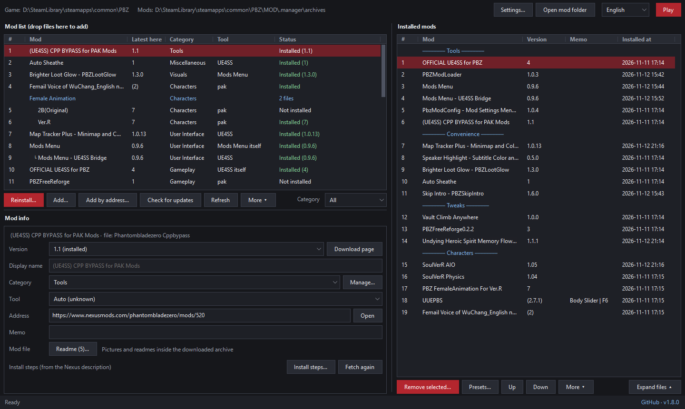
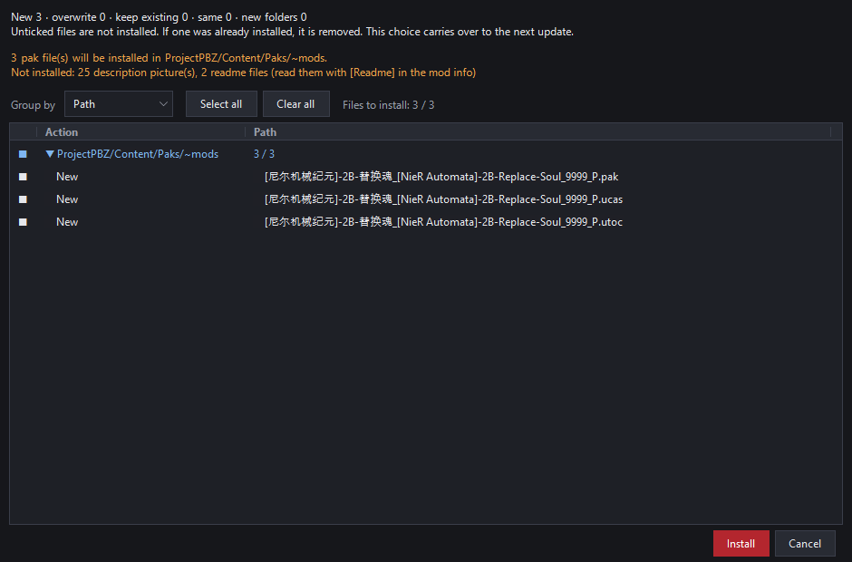
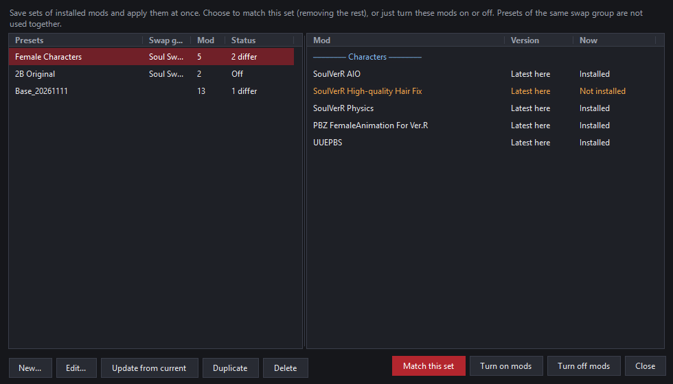
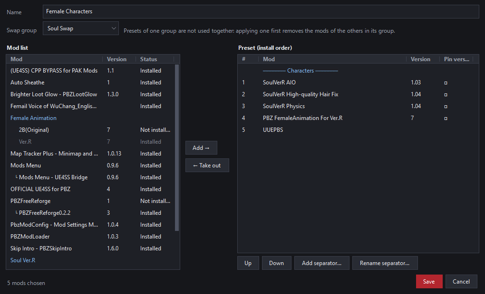

# PBZ Mod Manager

**English · [한국어](README.ko.md) · [简体中文](README.zh-CN.md) · [日本語](README.ja.md)**

A mod manager for Phantom Blade Zero. It installs downloaded mods where they belong, records every file it touches, and can put the game folder back exactly as it was.

> **Made for the Steam version.** Unofficial community tool, not affiliated with the game's developer or Nexus Mods.

## Quick start

1. Install the [.NET 8 Desktop Runtime](https://dotnet.microsoft.com/download/dotnet/8.0) (x64).
2. Download `PBZModManager.exe` from [Releases](https://github.com/GameStdio77/PBZModManager/releases), put it in any folder (for example, a `MOD` folder inside the game folder), and run it.
3. Drop a mod archive (zip, rar or 7z) on the window and type the **Nexus mod page address** in the info window's address field.
4. Pick the mod, press [Install...], check the preview and install.

## Features

- **Safe install and removal**: overwritten files are backed up, and removing a mod puts them back.
- **Install preview**: see where every file goes and leave out the ones you don't want.
- **Right place automatically**: JS, UE4SS, pak and Blueprint mods each go to their own folder.
- **Update check**: looks for newer versions on Nexus Mods and GitHub.
- **Versions**: several versions of a mod are one mod to update or roll back.
- **Presets**: save sets of mods and turn them on or off at once.
- **Readmes and pictures**: read the archive's readmes and see its pictures inside the manager.
- **Organizing and sharing**: install order, separators, memos, right-click menus, sharing your mod list
- **Four languages**: 한국어 · English · 简体中文 · 日本語

## Features in detail

### Install and removal

- Every file an install overwrites is backed up, and removing the mod restores it.
- Files changed or created after install are moved to a kept-files folder rather than deleted.
- The preview lists files by folder or by step; untick any to leave them out. Left-out files stay out on later updates.
- When a new version's options or install locations changed a lot, you are guided to remove the old version first.
- Installing and removing are blocked while the game runs.

### Install locations

| Mod | Goes to |
|---|---|
| JS mods | PBZModLoader (`ProjectPBZ/PBZModLoader/mods`) or Mods Menu (`.../JavaScript/PBZModsMenu/Mods`), whichever is installed; Mods Menu when both are |
| UE4SS itself | `platform/steam` |
| UE4SS Lua mods | `platform/steam/ue4ss/Mods` |
| pak mods | `Content/Paks/~mods` |
| Blueprint mods | `Content/Paks/LogicMods` |

Option folders that share files, such as "(choose one)", are installed one per group.

### Mod info

- Enter a mod's page address and its **category and install steps** are fetched with the public Nexus API. A GitHub repository address works too.
- Mods go by their **Nexus page title** rather than the file name. A name typed in [Display name] comes first.
- [Readme...] shows the archive's readmes and manuals (txt, md, rtf, html) right there; a PDF opens in your PDF viewer.
  - Readmes are left out of the install so they don't litter the game folder.
- [Pictures...] pages through the archive's pictures.

### Updates and versions

- [Check for updates] checks every mod that has an address. It runs only when you press it.
- When a newer version is out, open its download page and drop the downloaded file on the window to update.
- Several versions of a mod are one mod to update or downgrade; old version files can be cleaned up to the Recycle Bin.
- A file the author renamed on Nexus carries on as the next version of the same mod.
- From the right-click menu, check one mod alone or keep it out of checks.

### Presets

- Save sets of installed mods by name and apply them at once from [Presets...].
- Three ways to apply:
  - **Match this set**: mods not in the preset are removed
  - **Turn on mods**: only the preset's mods are installed
  - **Turn off mods**: only the preset's mods are removed
- Presets in the same **swap group** are not used together. Applying one first removes the mods of the others in its group (mods in both stay).
- Install order, separators, pinned versions, chosen options and left-out files are all kept.
- Before applying, you see what will change.

The editor has the mod list on the left and the preset, in install order, on the right. Put mods in, take them out, move them up or down.

### Organizing and sharing

- Reorder installed mods, add named separators and one-line memos.
- Install or remove several mods at once.
- Right-click a mod to install or remove it, check for updates, open its page, read its readme, find it in the other list and more.
- [Add by address...] holds a place for a mod you have not downloaded yet.
- [Share list...] sends your list as a file or as text, and the receiver loads it with [Import list...]. Importing only makes places; it downloads nothing.

### Settings

Changed from [Settings...] at the top right:

- Game folder, opening the mod folder
- Row number column, separator style
- What the manager does when the game starts: stay open / minimize to the taskbar / close
- Opening and emptying the kept-files folder

The language is picked at the top right and applies after a restart.

## Usage in detail

Show

1. Downloaded mod files and the install records all go in **the `.manager` folder next to the exe**.
2. The game folder is found automatically (folders above the exe, Steam libraries on every drive). If not, you are asked once; change it later in [Settings...].
3. Dropped files are **moved** into `.manager\archives`, not copied. A rar or 7z is kept as a zip of the same name and the original goes to the Recycle Bin.
4. For a mod it has not seen, the info window opens. **Type the mod page's address in the address field at the top.** The address is the only way the manager knows the mod's page.
   - Nexus address (`https://www.nexusmods.com/phantombladezero/mods/<number>`): the category and install steps are fetched automatically.
   - GitHub repository address: versions are checked against its GitHub releases.
   - A new version of a known mod takes over the earlier version's info.
5. Pick a mod and press [Install...] to see the preview. Untick files you want left out, then install.
6. [Check for updates] finds newer versions; drop the downloaded file on the window to update.
7. [Play] at the top right starts the game.

## The `.manager` folder

Show

| Item | Contents |
|---|---|
| `archives/` | The mod archives you added. [Open mod folder] opens it. |
| `history/` | Install records and backups of overwritten files. Needed to remove and undo; do not delete. |
| `leftovers/` | Files moved aside instead of deleted on removal. Can be emptied to the Recycle Bin from [Settings...]. |
| `meta.json` | Each mod's category, address, memo, tool, install steps |
| `wanted.json`, `shared-order.json` | Places held by address, and the order of an imported list |
| `renames.json` | Files renamed on Nexus, joined to the mod they were |
| `presets.json` | Presets |
| `settings.json` | Game folder, language, window place and settings |
| `order.json`, `categories.json`, `remote.json`, `log.txt` | List order and separators, categories, update check results, work log |

## Network use

- **Nexus Mods public GraphQL API** (`api.nexusmods.com/v2/graphql`): category and install steps when an address is entered, latest versions when [Check for updates] is pressed. No API key is used.
- **GitHub releases API** (`api.github.com`): latest versions of mods kept on GitHub, and once at start, whether this manager has a new version.
- Nothing is downloaded; download pages open in your browser.

## Credits

- Developed with Anthropic's AI [Claude](https://claude.com/claude-code) (Claude Code) and Google's AI [Gemini](https://gemini.google.com/).
- rar and 7z reading: [SharpCompress](https://github.com/adamhathcock/sharpcompress) (MIT)
- License: [GNU General Public License v3.0](LICENSE)
