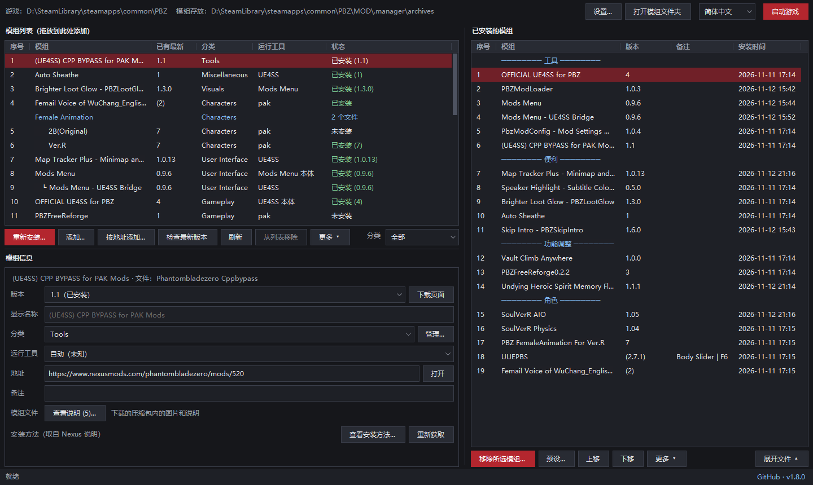
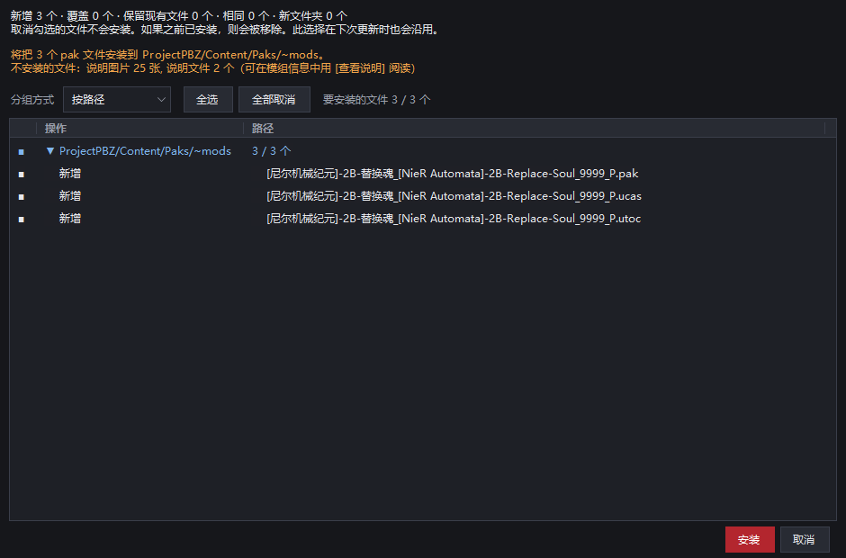
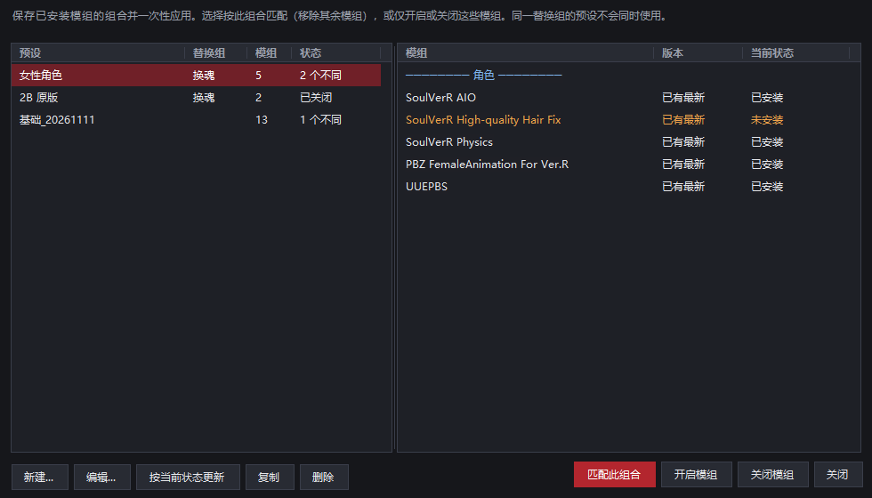
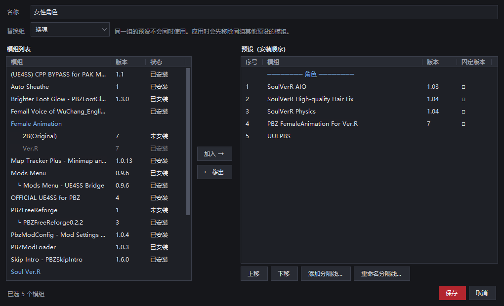

# PBZ Mod Manager

**[English](README.md) · [한국어](README.ko.md) · 简体中文 · [日本語](README.ja.md)**

Phantom Blade Zero（影之刃零）的模组管理器。把下载的模组安装到正确的位置，记录所有改动过的文件，并能随时把游戏文件夹恢复原状。

> **以 Steam 版为准**制作。非官方社区工具，与游戏开发商及 Nexus Mods 无关。

## 快速开始

1. 安装 [.NET 8 桌面运行时](https://dotnet.microsoft.com/download/dotnet/8.0)（x64）。
2. 从 [Releases](https://github.com/GameStdio77/PBZModManager/releases) 下载 `PBZModManager.exe`，放到任意文件夹（例如游戏文件夹中的 `MOD`）中运行。
3. 把模组压缩包（zip、rar、7z）拖到窗口中，在信息窗口的地址栏填写 **Nexus 模组页面地址**。
4. 选择模组，点击 [安装...]，确认预览后安装。

## 主要功能

- **安全的安装与移除**：备份被覆盖的文件，移除时恢复原状。
- **安装预览**：查看每个文件的去向，排除不想要的文件。
- **自动放到正确位置**：JS、UE4SS、pak、蓝图模组各自安装到对应的文件夹。
- **检查更新**：在 Nexus Mods 和 GitHub 上检查新版本。
- **版本管理**：同一模组的多个版本合为一个模组，可更新或回退。
- **预设**：保存模组组合，一次性开启或关闭。
- **查看说明与图片**：在管理器中直接阅读压缩包内的 readme、查看图片。
- **整理与分享**：安装顺序、分隔线、备注、右键菜单、分享模组列表
- **四种语言**：한국어 · English · 简体中文 · 日本語

## 功能详解

### 安装与移除

- 安装时备份所有被覆盖的文件，移除时恢复原状。
- 安装后被修改或新生成的文件不会删除，而是移到保留文件夹。
- 预览中可按路径或按操作查看文件，取消勾选即可排除。排除的文件在以后的更新中也保持排除。
- 新版本的选项构成或安装位置变化较大时，会提示先移除旧版本。
- 游戏运行时无法安装或移除。

### 安装位置

| 模组 | 安装位置 |
|---|---|
| JS 模组 | 已安装的 PBZModLoader（`ProjectPBZ/PBZModLoader/mods`）或 Mods Menu（`.../JavaScript/PBZModsMenu/Mods`）。两者都有时为 Mods Menu |
| UE4SS 本体 | `platform/steam` |
| UE4SS Lua 模组 | `platform/steam/ue4ss/Mods` |
| pak 模组 | `Content/Paks/~mods` |
| 蓝图模组 | `Content/Paks/LogicMods` |

像“(choose one)”这样共用文件的选项文件夹，每组选一个安装。

### 模组信息

- 填写模组页面地址后，通过 Nexus 公开 API 获取**分类和安装方法**。也可以填写 GitHub 仓库地址。
- 模组以 **Nexus 页面标题**而不是文件名显示。在 [显示名称] 中填写的名称优先。
- [查看说明...] 可直接阅读压缩包内的 readme 和说明文件（txt、md、rtf、html），PDF 用 PDF 程序打开。
  - 说明文件不会安装到游戏文件夹。
- [查看图片...] 可左右翻看压缩包内的图片。

### 更新与版本

- 点击 [检查最新版本] 会检查每个填写了地址的模组。只在点击时检查。
- 有新版本时可打开下载页面，把下载的文件拖到窗口即可更新。
- 同一模组的多个版本作为一个模组来更新或降级，旧版本文件可清理到回收站。
- 作者在 Nexus 上改了文件名时，也会作为同一模组的新版本继续管理。
- 在右键菜单中可以只检查一个模组，或把它排除在检查之外。

### 预设

- 为已安装模组的组合命名保存，在 [预设...] 中一次性应用。
- 应用方式有三种：
  - **匹配此组合**：移除不在预设中的模组
  - **开启模组**：只安装预设中的模组
  - **关闭模组**：只移除预设中的模组
- 同一**替换组**的预设不会同时使用。应用其中一个时，会先移除同组其他预设的模组（两者共有的模组保留）。
- 安装顺序、分隔线、固定版本、所选选项、排除的文件都会保存。
- 应用前显示将要发生的变化。

编辑窗口左侧是模组列表，右侧是预设（安装顺序）。可加入、移出模组并上下移动。

### 整理与分享

- 调整已安装模组的顺序，添加带名称的分隔线和一行备注。
- 一次安装或移除多个模组。
- 右键单击模组可直接安装或移除、检查更新、打开页面、查看说明、在另一个列表中查找等。
- 用 [按地址添加...] 为尚未下载的模组预留位置。
- 用 [分享列表...] 将列表以文件或文字发送，对方用 [导入列表...] 导入。导入只会预留位置，不会下载任何内容。

### 设置

在右上角的 [设置...] 中更改：

- 游戏文件夹、打开模组文件夹
- 序号列显示、分隔线样式
- 启动游戏时管理器的动作：保持打开 / 最小化到任务栏 / 自动退出
- 打开和清空保留文件夹

语言在右上角选择，重新启动后生效。

## 使用方法详解

展开

1. 下载的模组文件和安装记录都保存在**程序旁的 `.manager` 文件夹**中。
2. 会自动查找游戏文件夹（程序所在位置的上级文件夹、各磁盘的 Steam 库）。找不到时会让你选择一次，之后可在 [设置...] 中更改。
3. 拖入的文件会被**移动**（而不是复制）到 `.manager\archives`。rar 和 7z 会转换为同名的 zip 保存，原文件移到回收站。
4. 遇到新模组时会弹出信息窗口。**请在最上方的地址栏中填写模组页面地址。** 地址是管理器得知模组页面的唯一方式。
   - Nexus 地址（`https://www.nexusmods.com/phantombladezero/mods/编号`）：自动获取分类和安装方法。
   - GitHub 仓库地址：通过 GitHub Releases 检查版本。
   - 已知模组的新版本会沿用旧版本的信息。
5. 选择模组后点击 [安装...] 会显示预览。取消勾选不想安装的文件，然后安装。
6. 用 [检查最新版本] 查找新版本，把下载的文件拖到窗口即可更新。
7. 点击右上角的 [启动游戏] 可直接启动游戏。

## `.manager` 文件夹

展开

| 项目 | 内容 |
|---|---|
| `archives/` | 添加的模组压缩包。可用 [打开模组文件夹] 打开。 |
| `history/` | 安装记录和被覆盖原文件的备份。移除和撤销时需要，请勿删除。 |
| `leftovers/` | 移除时没有删除而移到这里的文件。可在 [设置...] 中清空到回收站。 |
| `meta.json` | 每个模组的分类、地址、备注、运行工具、安装方法 |
| `wanted.json`、`shared-order.json` | 按地址预留的位置，导入列表的安装顺序 |
| `renames.json` | 在 Nexus 上改名的文件与原模组的对应关系 |
| `presets.json` | 预设 |
| `settings.json` | 游戏文件夹、语言、窗口位置与设置 |
| `order.json`、`categories.json`、`remote.json`、`log.txt` | 列表顺序与分隔线、分类、最新版本检查结果、操作日志 |

## 网络使用

- **Nexus Mods 公开 GraphQL API**（`api.nexusmods.com/v2/graphql`）：填写地址时获取分类和安装方法，点击 [检查最新版本] 时获取最新版本。不使用 API 密钥。
- **GitHub Releases API**（`api.github.com`）：托管在 GitHub 上的模组的最新版本，以及启动时检查一次本管理器是否有新版本。
- 不会下载文件，只会在浏览器中打开下载页面。

## 致谢

- 本程序使用 Anthropic 的 AI [Claude](https://claude.com/claude-code)（Claude Code）与 Google 的 AI [Gemini](https://gemini.google.com/) 开发。
- rar、7z 读取：[SharpCompress](https://github.com/adamhathcock/sharpcompress)（MIT）
- 许可证：[GNU General Public License v3.0](LICENSE)
